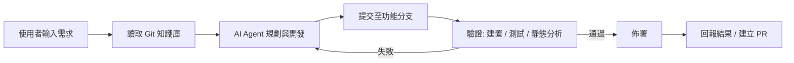

# Project Developing AI Assistant

連動 Git 與 AI Agent 的開發輔助系統。以指定的 Git Repository 作為知識庫，讓自定義的 AI Agent（Claude、ChatGPT 等大型語言模型）協助開發新專案。使用者只需在系統介面輸入需求，系統即可自動完成 **開發 → 驗證 → 佈署** 的工作流水線。

> 狀態：規劃中（尚未實作）

## 核心概念

- **Git 作為知識庫**：設定一或多個 Git Repository（程式碼、文件、規範、範本），Agent 以其內容作為開發的上下文與依據。
- **可抽換的 AI Agent**：透過統一的 Agent 介面串接不同 LLM（Claude、ChatGPT 等），可自訂 Prompt、角色與工具。
- **自動化流水線**：從需求輸入到佈署，各階段由系統編排並保留紀錄。
- **Git 原生工作流**：所有變更以分支、Commit、Pull Request 呈現，可審查、可回溯。

## 工作流程



1. **需求輸入**：使用者在介面中描述要開發的功能或專案。
2. **知識庫檢索**：系統從設定的 Repository 取得相關程式碼、文件與規範。
3. **開發**：Agent 產生計畫並修改程式碼，變更提交至獨立功能分支。
4. **驗證**：自動執行建置、單元／整合測試與靜態分析；失敗時回饋給 Agent 修正。
5. **佈署**：驗證通過後依設定的環境與策略佈署。
6. **回報**：於介面顯示每個階段的狀態、日誌與差異，並可建立 Pull Request。

## 預計功能

- Git Repository 連線與設定（知識庫、目標專案）
- 多 LLM Provider 設定與自訂 Agent（角色、Prompt、可用工具）
- 需求輸入介面與任務進度、日誌即時檢視
- 可設定的驗證步驟（建置、測試、Lint）
- 可設定的佈署目標與策略
- 人工確認關卡（例如佈署前核准）
- 任務歷史與稽核紀錄

## 系統架構（規劃）

| 模組 | 職責 |
| --- | --- |
| Web UI | 需求輸入、任務與日誌檢視、設定管理 |
| Orchestrator | 編排 開發 → 驗證 → 佈署 流水線與狀態管理 |
| Git Integration | Clone、分支、Commit、Push、PR 與知識庫讀取 |
| Agent Runtime | 統一介面呼叫各 LLM，管理上下文與工具 |
| Validator | 執行建置、測試、分析並回傳結果 |
| Deployer | 依設定執行佈署 |

## 設定範例（草案）

```yaml
knowledgeBase:
  repositories:
    - url: https://example.com/org/knowledge-repo.git
      branch: main

agent:
  provider: claude        # claude | openai | ...
  model: <model-name>
  systemPrompt: ./prompts/developer.md

pipeline:
  validate:
    - build
    - test
  deploy:
    target: staging
    requireApproval: true
```

## 安全性注意事項

- API 金鑰與 Git 憑證請使用環境變數或密鑰管理服務，不要提交至版本庫。
- Agent 的檔案與指令執行應於隔離環境（容器／沙箱）中進行。
- 佈署至正式環境前建議啟用人工核准。

## 開發計畫

- [ ] 確認技術棧與專案骨架
- [ ] Git 整合與知識庫讀取
- [ ] Agent 抽象層與第一個 LLM Provider
- [ ] 流水線編排（開發 → 驗證）
- [ ] 佈署模組
- [ ] Web UI

## 授權

尚未指定。
