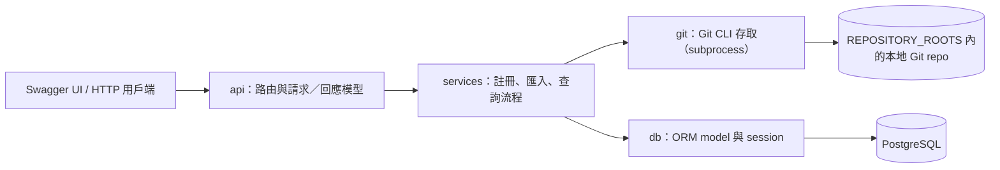

# RepoPilot 架構

> 本文件描述**目前實際**架構；各模組狀態見下表，標為「未完成」的內容尚未存在於程式碼。

## 第一階段架構

模組化單體，同步 FastAPI handler 與同步 SQLAlchemy。

| 模組 | 職責 | 狀態 |
| --- | --- | --- |
| `repopilot.main` | `create_app()` 應用程式工廠；組裝 middleware、exception handler、路由 | 已完成 |
| `repopilot.config` | pydantic-settings 設定；目前有 `APP_NAME`、`LOG_LEVEL`、`DATABASE_URL`（`SecretStr`）、`DB_CONNECT_TIMEOUT_SECONDS`、`DB_POOL_SIZE`、`DB_MAX_OVERFLOW`、`DB_POOL_TIMEOUT_SECONDS`、`REPOSITORY_ROOTS`、`GIT_TIMEOUT_SECONDS`，以及匯入設定 `IMPORT_MAX_FILE_BYTES`、`IMPORT_MAX_FILES`、`IMPORT_MAX_SNAPSHOT_BYTES`、`IMPORT_GIT_TIMEOUT_SECONDS`、`IMPORT_STALE_SECONDS`、`IMPORT_EXCLUDED_PATTERNS`、`IMPORT_EXCLUDED_EXCEPTIONS` | 已完成 |
| `repopilot.logging_config` | 單行 JSON 日誌，自動帶 `request_id` 與 `extra` 欄位 | 已完成 |
| `repopilot.api.middleware` | `RequestIdMiddleware`：request ID、存取日誌（method、path、status_code、duration_ms）、未預期例外轉 500 | 已完成 |
| `repopilot.api.errors` | 統一錯誤格式；領域例外 → HTTP 狀態碼對照表 `ERROR_STATUS` | 已完成 |
| `repopilot.api.routes` | 路由；目前有 `GET /health`、`GET /ready`、`POST／GET /api/v1/repositories`、`GET /api/v1/repositories/{id}`、`POST /api/v1/repositories/{id}/imports`；`api/schemas.py` 為請求／回應模型 | 已完成（快照與檔案查詢路由未完成） |
| `repopilot.errors` | 領域例外基底 `RepoPilotError`（穩定 `code`）：`DatabaseUnavailableError`（503）、`InvalidRepositoryPathError`（422）、`RepositoryNotFoundError`（404）、`InvalidRevisionError`（422）、`ImportLimitExceededError`（422）、`SnapshotImportInProgressError`（409）、`GitCommandError`（500）、`GitTimeoutError`（504）；SQLAlchemy `OperationalError` 亦轉為 503 | 已完成 |
| `repopilot.services` | `services/repositories.py`：路徑正規化與 `REPOSITORY_ROOTS` 檢查、註冊（冪等）、列表、查詢；`services/import_profile.py`：匯入設定、排除規則與雜湊；`services/snapshots.py`：取得所有權、分類、一次性寫入、失敗標記；快照與檔案查詢未完成 | 已完成（匯入；查詢未完成） |
| `repopilot.git` | `runner.run_git`：參數陣列、`shell=False`、逾時、移除 `GIT_DIR` 等環境變數、`GIT_TERMINAL_PROMPT=0`、可傳入 stdin；`repository.ensure_repository_root`：非 bare、`--show-toplevel` 等於註冊路徑；`objects`：`resolve_commit`（`rev-parse --verify --quiet --end-of-options <rev>^{commit}`）、`list_tree`（`ls-tree -r -l -z --full-tree`）、`read_blobs`（單一 `cat-file --batch`） | 已完成 |
| `repopilot.db` | `Base`（約束命名規則）、Engine／Session 工廠、`get_session` dependency、ORM model `Repository`、`Snapshot`、`SnapshotFile`；Alembic 位於專案根目錄 `migrations/`（`0001` 空基線、`0002` repositories、`0003` snapshots／snapshot_files） | 已完成 |

### 路徑區分

- **本機 repo 路徑**：被匯入的 Git repo，例如 `D:\repos\demo`，必須位於 `REPOSITORY_ROOTS` 內；API 服務直接在主機上讀取。
- **容器 volume**：只存放 PostgreSQL 資料庫檔，**不是**被匯入的 Git repo。

## 資料模型

以 migration `0002`、`0003` 為準。

- `Repository`：`canonical_local_path` 唯一（`uq_repositories_canonical_local_path`）。
- `Snapshot`：唯一約束 `uq_snapshots_repository_id_commit_sha_import_profile_hash`；`status` 為 `importing`／`completed`／`failed`（CHECK 約束）；`file_count` 為 `imported` 檔案數、`skipped_count` 為 `skipped` 列數、`total_bytes` 為實際讀取的 blob 位元組總和（不含 `excluded`、`too_large`、symlink、submodule 等未讀取者）；`started_at` 同時是匯入所有權憑證（見 D24）。
- `SnapshotFile`：唯一約束 `uq_snapshot_files_snapshot_id_path`，隨 snapshot 刪除而級聯；`status` 為 `imported`／`skipped`；CHECK 約束保證「`imported` 若且唯若 `content` 非 NULL」。
  - `skip_reason`：`binary`、`invalid_utf8`、`too_large`、`excluded`、`symlink`、`submodule`、`unsafe_path`、`unsupported`。
  - `excluded`、`too_large`、symlink：有 `git_blob_id` 與 `byte_size`（來自 `ls-tree`），無 `sha256`；submodule、`unsafe_path`、`unsupported`：`git_blob_id`、`sha256`、`byte_size` 皆為 NULL；`binary`、`invalid_utf8`：有 `sha256` 與 `byte_size`，無 `content`。

## 設計決策

以下為規格未定、由實作選擇的預設；實作完成並驗證後標註狀態。

| # | 決策 | 理由 | 取捨／替代方案 | 狀態 |
| --- | --- | --- | --- | --- |
| D1 | Python 固定 3.12（`requires-python = ">=3.12"`，`.python-version` 為 3.12） | 符合技術棧下限，避免依賴尚未支援新版 Python 的套件 | 本機 3.14 亦可用，但相容性風險較高 | 已完成 |
| D2 | 重複註冊相同 repo 回 200 與既有資料；新建回 201 | 冪等，用戶端不需先查詢 | 亦可回 409，但對自動化較不友善 | 已完成（切片 3） |
| D3 | 重複匯入已完成快照回 200 與既有快照；新建回 201；相同快照匯入中回 409 | 冪等並明確區分匯入中 | — | 已完成（切片 4） |
| D4 | 失敗快照重試時重用同一筆：以條件式 `UPDATE ... WHERE status='failed'`（或逾時的 `importing`）取得所有權，並刪除殘留檔案列；`completed` 與檔案列在同一交易提交 | 遵守唯一約束且不留下半套資料；失敗時檔案列隨交易 rollback，不會存在 | 另建新列需放寬唯一約束 | 已完成（切片 4） |
| D5 | 預設上限：單檔 1 MiB、檔案數 20,000、快照總大小 200 MiB、Git 指令逾時 30 秒、讀取全部 blob 逾時 300 秒，皆可設定 | 保護同步請求與資料庫 | 數值未經實測，之後依實測調整；單一 `cat-file --batch` 的輸出會整批載入記憶體（上限約等於快照總大小上限） | 已完成（切片 4；數值未實測） |
| D6 | 以應用程式工廠 `create_app()` 搭配 `uvicorn --factory` 啟動，不在模組層建立 `app` | 遵守「匯入模組不執行 I/O」；測試可注入 `Settings` | 啟動指令多一個 `--factory` 參數 | 已完成 |
| D7 | request ID 以純 ASGI middleware 實作；接受合法的 `X-Request-ID`（`[A-Za-z0-9._-]{1,64}`），否則產生 UUID4 hex | contextvar 可在 exception handler 與 threadpool 中的同步 handler 讀到；限制字元避免日誌注入 | `BaseHTTPMiddleware` 較簡單，但 contextvar 與例外處理行為較難掌握 | 已完成 |
| D8 | 未預期例外由 `RequestIdMiddleware` 攔截並回統一格式 500（帶 `X-Request-ID`），日誌記錄堆疊 | Starlette 的 `ServerErrorMiddleware` 位於最外層，回應不會帶 request ID 標頭 | — | 已完成 |
| D9 | 422 錯誤額外提供 `details`（`loc`、`msg`、`type`），不回傳 `input`／`ctx` | 讓用戶端知道哪個欄位錯；避免回顯可能含秘密的原始輸入 | 規格錯誤格式只有 `code`／`message`／`request_id`，此為增列欄位 | 已完成 |
| D10 | 領域例外只帶 `code`，HTTP 狀態碼由 API 層的 `ERROR_STATUS` 對照表決定，未列出者回 500 | service 層不依賴 HTTP 概念 | 對照表需隨新例外更新 | 已完成 |
| D11 | Ruff 停用 RUF001～RUF003 | 專案以繁體中文撰寫註解，全形標點不是混淆字元 | 無法偵測真正誤用的全形字元 | 已完成 |
| D12 | PostgreSQL 驅動用 psycopg 3（`psycopg[binary]`），連線字串 `postgresql+psycopg://` | 同步 SQLAlchemy 官方支援，內建二進位套件免本機編譯 | psycopg2 較舊；asyncpg 為非同步，與第一階段同步原則不符 | 已完成 |
| D13 | Compose 提供 `db`（具名 volume，埠 5432）與 `db-test`（tmpfs，埠 5433），皆只綁 `127.0.0.1`，映像 `postgres:17`；帳密為文件化的本機假值 | 測試資料庫每次重建皆乾淨、不污染開發資料；不對外網開放 | 預設帳密不可用於共用環境；映像未鎖 patch 版本 | 已完成 |
| D14 | `DATABASE_URL` 以 `SecretStr` 保存；Engine 建立時不連線，由 lifespan 關閉時 `dispose()`；`/ready` 失敗只記錄例外型別、回應不含連線資訊 | 避免密碼進入日誌與回應；匯入模組與建立應用程式不執行 I/O | `pool_pre_ping` 每次取連線多一次檢查 | 已完成 |
| D17 | 連線池大小、溢出數與等待逾時可由設定調整，預設與 SQLAlchemy 相同（5、10、30 秒） | 同步 handler 在 threadpool 執行（約 40 條），可能多於連線池；匯入等長流程需要能調整 | 預設值未經實測，不代表適合本專案負載；Session 持有交易期間會佔用連線，不應在交易內執行長時間 Git 工作 | 已完成 |
| D15 | Alembic 放在專案根目錄 `migrations/`，連線字串由 `env.py` 從 Settings 讀取（測試可經 `config.attributes` 注入）；先建立空基線 `0001` | 確認 migration 流程與 `alembic_version` 可運作，資料表留給後續切片 | 空基線在切片 3 前沒有實際 schema；`alembic.ini` 須維持 ASCII，否則 Windows 非 UTF-8 地區設定下 `configparser` 讀取失敗 | 已完成 |
| D16 | 整合測試資料庫不可連線時以 `pytest.fail` 明確失敗，不跳過；`TEST_DATABASE_URL` 名稱不含 `test` 即拒絕；session 啟動時重建 `public` schema | 規則 10：PostgreSQL 未驗證就不能視為通過；避免誤清開發資料庫 | 未啟動 `db-test` 時 `uv run pytest` 會有失敗 | 已完成 |
| D18 | 註冊路徑須為絕對路徑，經 `resolve(strict=True)` 後以 `is_relative_to` 比對已 resolve 的 `REPOSITORY_ROOTS`；`REPOSITORY_ROOTS` 預設為空（拒絕全部）；不存在的根目錄略過並記錄警告 | 預設拒絕較安全；`resolve` 展開 symlink／junction、`..`、短檔名並還原實際大小寫，使去重與越界檢查一致 | 使用者須先設定 `REPOSITORY_ROOTS` 才能註冊；`canonical_local_path` 含平台分隔符，跨平台搬移資料庫不可直接沿用 | 已完成（切片 3） |
| D19 | Repository 根目錄判斷：`rev-parse --is-bare-repository` 非 true，且 `--show-toplevel` resolve 後等於註冊路徑；bare repo、子目錄、`.git` 目錄皆回 422；Git 因 `dubious ownership` 拒絕時回明確訊息，不修改 `safe.directory` | 符合「只接受 repo 根目錄」與不改動使用者 Git 設定 | 使用者全域 `safe.bareRepository=explicit` 時 bare repo 以 stderr 判斷，依賴 Git 訊息文字 | 已完成（切片 3；dubious ownership 分支未實測） |
| D20 | 重複註冊以「先查、再 insert、捕捉 `uq_repositories_canonical_local_path` 的 IntegrityError 後重新查詢」處理；`name` 預設為目錄名稱，重複註冊不更新既有名稱 | 併發下仍只有一筆；唯一性由資料庫約束保證 | 重複註冊無法改名（需另有 Update 端點，本階段不提供） | 已完成（切片 3） |
| D21 | 回應 `GET /api/v1/repositories` 為 `{"items": [...]}`，暫不分頁 | 預期 repo 數量少；包成物件以便日後加入分頁欄位而不破壞契約 | 數量大時需補分頁 | 已完成（切片 3） |
| D22 | revision 解析：先拒絕空字串、超過 256 字元、`-` 開頭、控制字元（含 NUL、換行），再執行 `rev-parse --verify --quiet --end-of-options <rev>^{commit}`；exit 1 為 `invalid_revision`（422），其他非 0 為 `git_command_failed`（500）；輸出須為 40 或 64 位 hex。Git 版本以 2.47.0 實測 | 區分使用者輸入錯誤與 Git 執行錯誤；`^{commit}` 使 tag 還原為 commit、拒絕 tree／blob | `--quiet` 下無法區分「revision 不存在」與「存在但不是 commit」（皆 422） | 已完成（切片 4） |
| D23 | 匯入流程在記憶體內完成分類（先以 `ls-tree -l` 的大小判斷，超限的檔案與快照不讀 blob），再以單一 `cat-file --batch` 讀取需要的 blob（相同 blob 只讀一次），最後在一個交易寫入；寫入前不持有資料庫交易。blob header 的大小須與 `ls-tree` 一致 | 避免每檔一個 subprocess；Git 作業期間不佔用連線（呼應 D17）；失敗時不需清理 | 記憶體用量約為快照總大小上限的數倍（位元組＋解碼後文字） | 已完成（切片 4） |
| D24 | 取得所有權：先 INSERT `importing` 快照並立即提交，捕捉 `uq_snapshots_...` 的 IntegrityError 後讀取既有列：`completed` 回傳、新鮮的 `importing` 回 409、`failed` 或逾時（`IMPORT_STALE_SECONDS`，預設 1800 秒）的 `importing` 以條件式 UPDATE 接手。完成與標記失敗的 UPDATE 皆比對 `started_at` 憑證，被接手後的舊請求回 409 且不覆寫新擁有者 | 唯一性由資料庫仲裁；程序中斷不會讓快照永遠卡在 `importing`；舊請求不會與新擁有者互相覆寫 | 逾時值必須大於實際匯入時間，否則進行中的匯入會被接手（舊請求會因憑證不符而失敗，不會產生半套資料） | 已完成（切片 4） |
| D25 | 分類規則：一般檔案（mode `100xxx`）才讀內容；`120000`→`symlink`、`160000`→`submodule`（皆不讀內容）；路徑含 `..`、`.`、空區段或 `.git` 區段→`unsafe_path`；其他物件／mode→`unsupported`。二進位判斷為「**整個內容**含 NUL」（比 skill 的前 8000 bytes 更嚴格，因為 PostgreSQL `text` 不接受 NUL）；嚴格 UTF-8 解碼失敗為 `invalid_utf8`；BOM 與換行原樣保留 | 防止惡意 tree 的路徑穿越；避免資料庫寫入錯誤 | 前 8000 bytes 無 NUL 但之後有 NUL 的文字檔會被視為 binary | 已完成（切片 4） |
| D26 | 排除規則以「檔名（不分大小寫、fnmatch）」比對，預設：`.env`、`.env.*`、`*.pem`、`*.key`、`id_rsa*`、`id_ed25519*`、`*.p12`、`*.pfx`、`credentials*.json`、`.npmrc`、`.pypirc`、`.netrc`，例外 `.env.example`；可由 `IMPORT_EXCLUDED_PATTERNS`／`IMPORT_EXCLUDED_EXCEPTIONS`（JSON 陣列）調整。`import_profile_hash` 為「設定版本、排序後的排除規則與例外、三項上限」的 JSON 取 SHA-256 | 排除規則或上限不同會得到不同的快照，而不是被誤認為相同結果；排除檔不讀內容、不保存 SHA-256 | 只比對檔名，不支援目錄層級規則；改變任何設定都會使既有快照不被重用 | 已完成（切片 4） |
| D27 | 無法以 UTF-8 解碼的路徑以 `backslashreplace` 保留為 `\xNN` 字面文字；若因此與其他路徑重複，唯一約束使整個匯入失敗 | 資料庫 `text` 無法保存無效 UTF-8；極少見 | 路徑與 Git 中的實際位元組不完全一致 | 已完成（切片 4；未以真實非 UTF-8 檔名驗證） |
| D28 | 匯入前重新驗證 repo 路徑（仍在 `REPOSITORY_ROOTS` 內且為 repo 根目錄），失敗回 422 `invalid_repository_path`；`error_summary` 只含領域例外訊息或例外型別（截斷 500 字元），不含檔案內容 | repo 可能在註冊後被移動或刪除；避免秘密外洩 | — | 已完成（切片 4） |

## 未來擴充（計畫）

- 第二階段：Celery + Redis worker 接手匯入與索引；Python `ast` 符號索引。
- 第三階段起：pgvector、embedding 與生成模型介面。
- 長期構想：透過系統介面串接 CI/CD（見 [product.md](./product.md#長期願景尚未排入階段)）。
