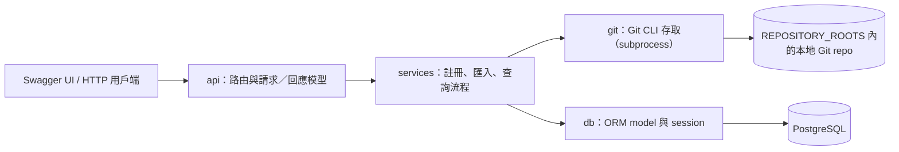

# RepoPilot 架構

> 本文件描述**目前實際**架構；各模組狀態見下表，標為「未完成」的內容尚未存在於程式碼。

## 第一階段架構

模組化單體，同步 FastAPI handler 與同步 SQLAlchemy。

| 模組 | 職責 | 狀態 |
| --- | --- | --- |
| `repopilot.main` | `create_app()` 應用程式工廠；組裝 middleware、exception handler、路由 | 已完成 |
| `repopilot.config` | pydantic-settings 設定；目前有 `APP_NAME`、`LOG_LEVEL`（`DATABASE_URL`、`REPOSITORY_ROOTS`、匯入上限於後續切片加入） | 已完成（部分欄位未完成） |
| `repopilot.logging_config` | 單行 JSON 日誌，自動帶 `request_id` 與 `extra` 欄位 | 已完成 |
| `repopilot.api.middleware` | `RequestIdMiddleware`：request ID、存取日誌（method、path、status_code、duration_ms）、未預期例外轉 500 | 已完成 |
| `repopilot.api.errors` | 統一錯誤格式；領域例外 → HTTP 狀態碼對照表 `ERROR_STATUS` | 已完成 |
| `repopilot.api.routes` | 路由；目前有 `GET /health` | 已完成（其餘未完成） |
| `repopilot.errors` | 領域例外基底 `RepoPilotError`（穩定 `code`） | 已完成 |
| `repopilot.services` | Repository 註冊、快照匯入、查詢 | 未完成 |
| `repopilot.git` | 以參數陣列呼叫 Git CLI、逾時、錯誤轉換 | 未完成 |
| `repopilot.db` | SQLAlchemy model、session、Alembic migration | 未完成 |

### 路徑區分

- **本機 repo 路徑**：被匯入的 Git repo，例如 `D:\repos\demo`，必須位於 `REPOSITORY_ROOTS` 內；API 服務直接在主機上讀取。
- **容器 volume**：只存放 PostgreSQL 資料庫檔，**不是**被匯入的 Git repo。

## 資料模型（規劃）

詳見第一階段規格；實作後以實際 migration 為準補上欄位表。

- `Repository`：`canonical_local_path` 唯一。
- `Snapshot`：唯一約束 `repository_id + commit_sha + import_profile_hash`；`status` 為 `importing`／`completed`／`failed`。
- `SnapshotFile`：唯一約束 `snapshot_id + path`；`status` 為 `imported`／`skipped`，附 `skip_reason`。

## 設計決策

以下為規格未定、由實作選擇的預設；實作完成並驗證後標註狀態。

| # | 決策 | 理由 | 取捨／替代方案 | 狀態 |
| --- | --- | --- | --- | --- |
| D1 | Python 固定 3.12（`requires-python = ">=3.12"`，`.python-version` 為 3.12） | 符合技術棧下限，避免依賴尚未支援新版 Python 的套件 | 本機 3.14 亦可用，但相容性風險較高 | 已完成 |
| D2 | 重複註冊相同 repo 回 200 與既有資料；新建回 201 | 冪等，用戶端不需先查詢 | 亦可回 409，但對自動化較不友善 | 未完成 |
| D3 | 重複匯入已完成快照回 200 與既有快照；新建回 201；相同快照匯入中回 409 | 冪等並明確區分匯入中 | — | 未完成 |
| D4 | 失敗快照重試時重用同一筆，於同一交易內刪除舊檔案列並重設為 `importing` | 遵守唯一約束且不留下半套資料 | 另建新列需放寬唯一約束 | 未完成 |
| D5 | 預設上限：單檔 1 MiB、檔案數 20,000、快照總大小 200 MiB、Git 指令逾時 30 秒，皆可設定 | 保護同步請求與資料庫 | 數值未經實測，之後依實測調整 | 未完成 |
| D6 | 以應用程式工廠 `create_app()` 搭配 `uvicorn --factory` 啟動，不在模組層建立 `app` | 遵守「匯入模組不執行 I/O」；測試可注入 `Settings` | 啟動指令多一個 `--factory` 參數 | 已完成 |
| D7 | request ID 以純 ASGI middleware 實作；接受合法的 `X-Request-ID`（`[A-Za-z0-9._-]{1,64}`），否則產生 UUID4 hex | contextvar 可在 exception handler 與 threadpool 中的同步 handler 讀到；限制字元避免日誌注入 | `BaseHTTPMiddleware` 較簡單，但 contextvar 與例外處理行為較難掌握 | 已完成 |
| D8 | 未預期例外由 `RequestIdMiddleware` 攔截並回統一格式 500（帶 `X-Request-ID`），日誌記錄堆疊 | Starlette 的 `ServerErrorMiddleware` 位於最外層，回應不會帶 request ID 標頭 | — | 已完成 |
| D9 | 422 錯誤額外提供 `details`（`loc`、`msg`、`type`），不回傳 `input`／`ctx` | 讓用戶端知道哪個欄位錯；避免回顯可能含秘密的原始輸入 | 規格錯誤格式只有 `code`／`message`／`request_id`，此為增列欄位 | 已完成 |
| D10 | 領域例外只帶 `code`，HTTP 狀態碼由 API 層的 `ERROR_STATUS` 對照表決定，未列出者回 500 | service 層不依賴 HTTP 概念 | 對照表需隨新例外更新 | 已完成 |
| D11 | Ruff 停用 RUF001～RUF003 | 專案以繁體中文撰寫註解，全形標點不是混淆字元 | 無法偵測真正誤用的全形字元 | 已完成 |

## 未來擴充（計畫）

- 第二階段：Celery + Redis worker 接手匯入與索引；Python `ast` 符號索引。
- 第三階段起：pgvector、embedding 與生成模型介面。
- 長期構想：透過系統介面串接 CI/CD（見 [product.md](./product.md#長期願景尚未排入階段)）。
